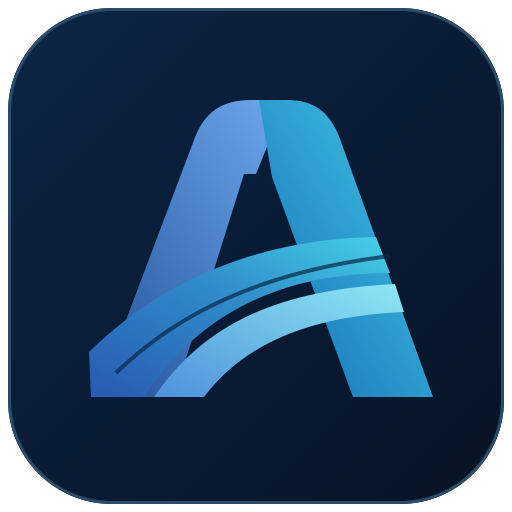

# Agorail Labs — organization community files

This public repository powers the [Agorail Labs organization profile](https://github.com/agorail-labs) and provides default community guidance where a project has not supplied its own.

- [Organization homepage](profile/README.md)
- [Project scope and relationship](PROJECTS.md)
- [Contributing](CONTRIBUTING.md)
- [Governance](GOVERNANCE.md)
- [Code of conduct](CODE_OF_CONDUCT.md)
- [Security reporting](SECURITY.md)
- [Support and where to ask](SUPPORT.md)

**Active research repositories:** [Subscription Change Quote](https://github.com/agorail-labs/subscription-change-quote) and [Mutation Safety Envelope](https://github.com/agorail-labs/mutation-safety-envelope).

Project-specific guidelines, evidence registers, and security disclosures take precedence over these defaults. The projects are experimental; Agorail Labs does not claim production certification, external standards adoption, or vendor endorsement.
